<!-- 源地址: https://iot.mi.com/vela/quickapp/en/guide/start/use-ide.html -->
<!-- 最近更新日期: 2026-06-23 -->

# Developing JS Applications with AIoT-IDE

## Download AIoT-IDE

This application supports **macOS** , **Windows** , and **Ubuntu** systems. Please ensure your device meets the following minimum system version requirements.

* * *

## System Requirements

Operating System | Minimum Version Required
---|---
macOS | 14 (Sonoma) or later
Windows | 10 or later
Ubuntu | 20.04 LTS or later

## Installing AIoT-IDE

On mac versions, you may encounter installation errors as follows:

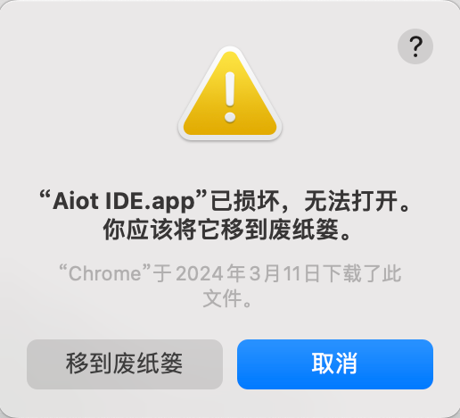

If you encounter such issues, follow these steps:

  1. Open a shell window and enter: `sudo xattr -r -d com.apple.quarantine`, as shown in Example 1 below.
  2. Press the spacebar **and then drag the application into the window** , resulting in Example 2 below.
  3. Press Enter, enter your password, and then execute the program.

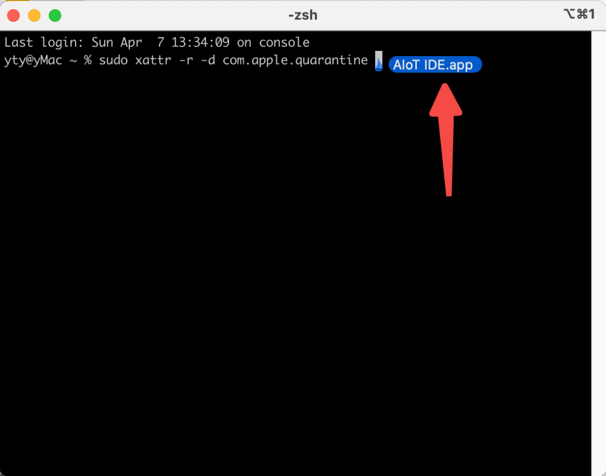

Example 1

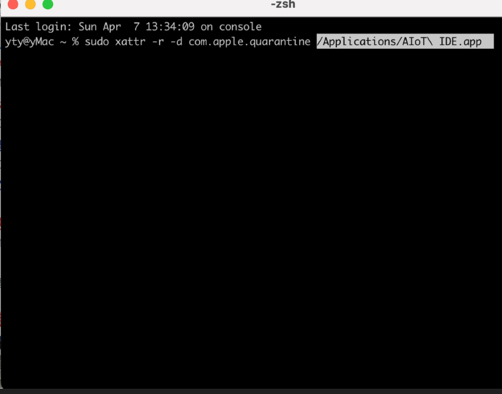

Example 2

## Historical Versions

Historical versions can be found [here (opens new window)](<https://kpan.mioffice.cn/webfolder/ext/j6SfQsarf8I%40?n=0.18700074913007825>)
Password: 99E6

## Using AIoT-IDE

### 1\. Initializing a Vela Project

  * Open the project initialization graphical interface by clicking "File" > "New Project" in the top-left corner.
  * Click "Watch" on the left sidebar of the card and then click "Create".
  * Select a project template and click "Next".
  * Enter the project name and save path, then click "Create" and wait for the project to be created.

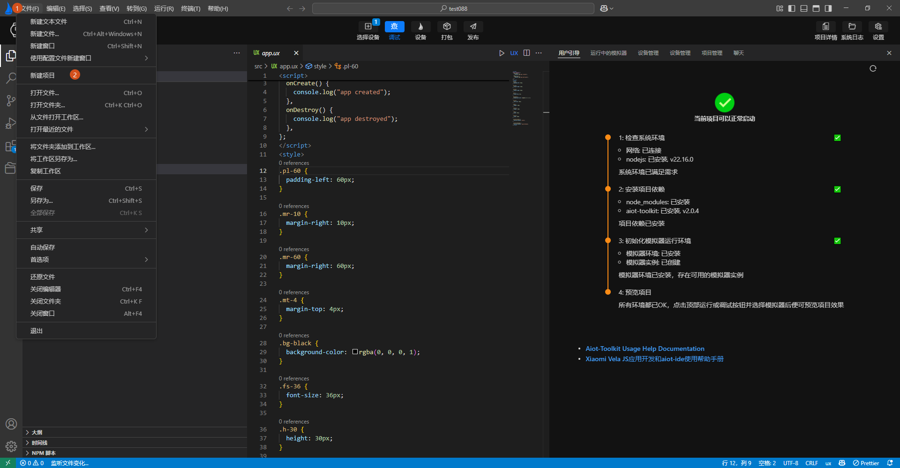

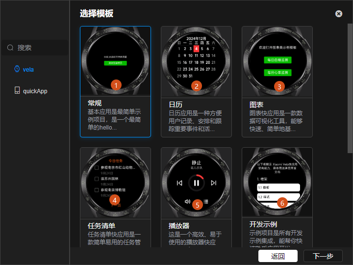

### 2\. Project Development

Supports dependency installation, debugging, simulator management, and project packaging.
After opening a Vela Quick App project, AIoT-IDE will display a top banner with operation buttons and a development guide on the right. Follow the guide to install the necessary dependencies.
Once the dependencies are installed, click the operation buttons in the banner to perform corresponding functions.

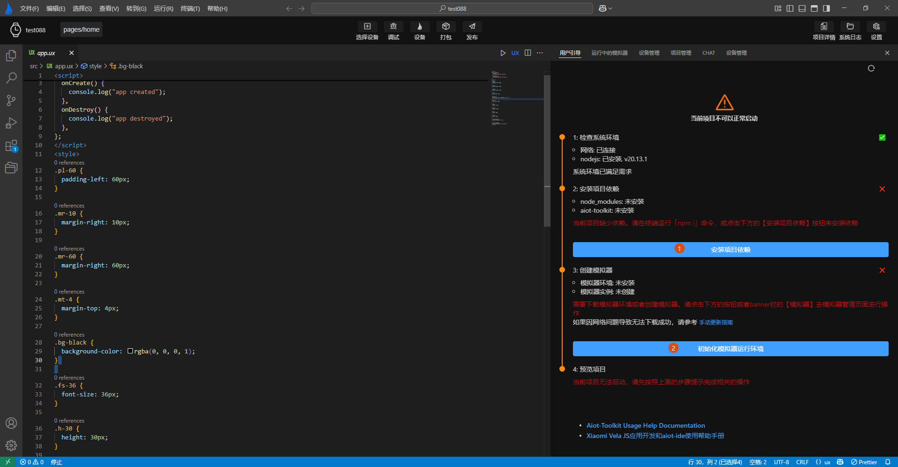

### 3\. Development Guide

When opening a Vela Quick App project, AIoT-IDE will display a development guide on the right to assist with development. Follow the guide's instructions to complete the corresponding operations.

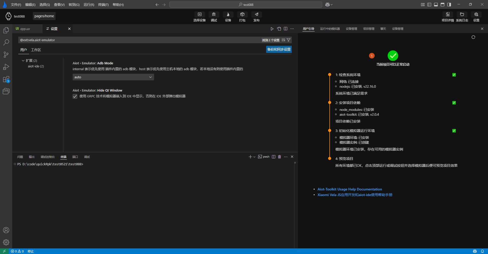

If you encounter npm package download failures with `npm i` as per the guide, follow these steps to resolve:

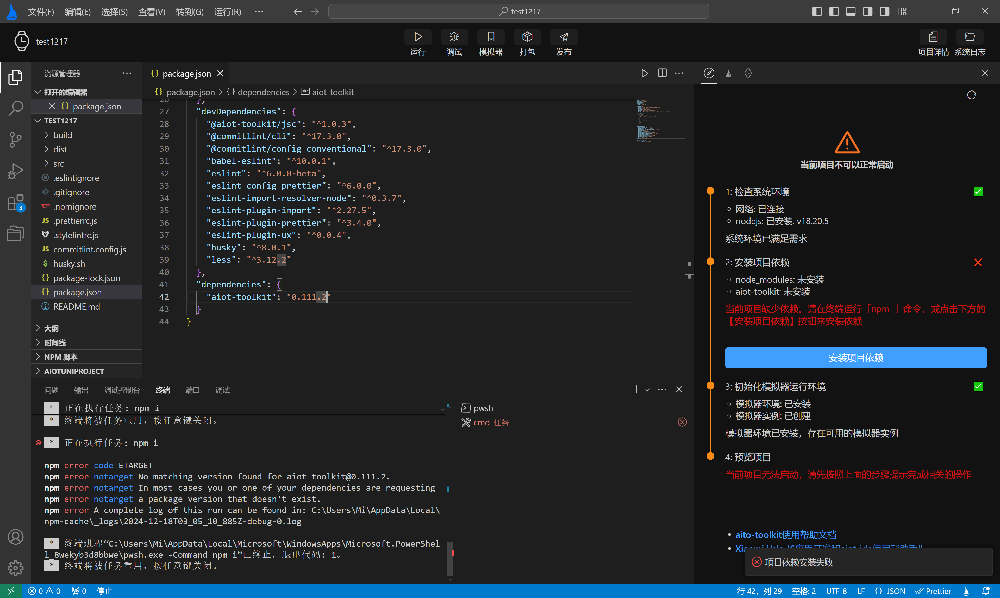

  * Check if there is a `.npmrc` file in the current project's root directory. If not, create one.

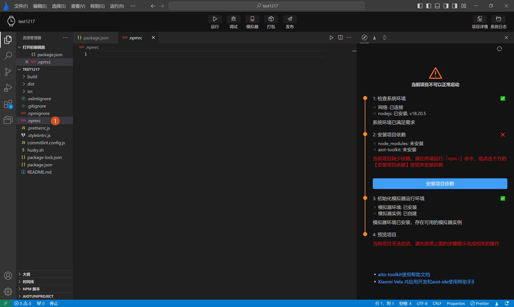

  * Open the `.npmrc` file and copy the following content into it:

`registry="https://registry.npmmirror.com/"`

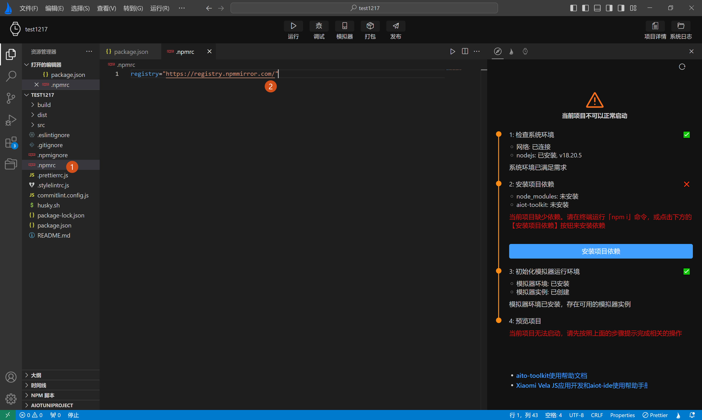

  * Open the terminal and run `npm i` again.

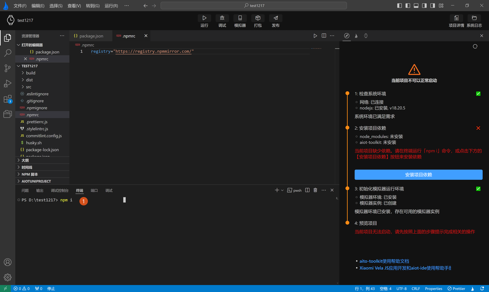

### 4\. Simulator Environment Management

AIoT-IDE supports automatic initialization of the simulator environment, creation, deletion, and listing of simulators to allow viewing effects on different simulators during runtime/debugging.

**Simulator Environment Description**

If the simulator environment and instances are missing, the development guide will provide corresponding prompts.

  * Click the "Check Simulator Environment, Create Simulator Instance" button and select "Auto Install" in the pop-up modal window. The plugin will automatically install the simulator-related dependencies.
  * On the simulator list page, click the "Create" button in the top-left corner to generate a simulator instance.

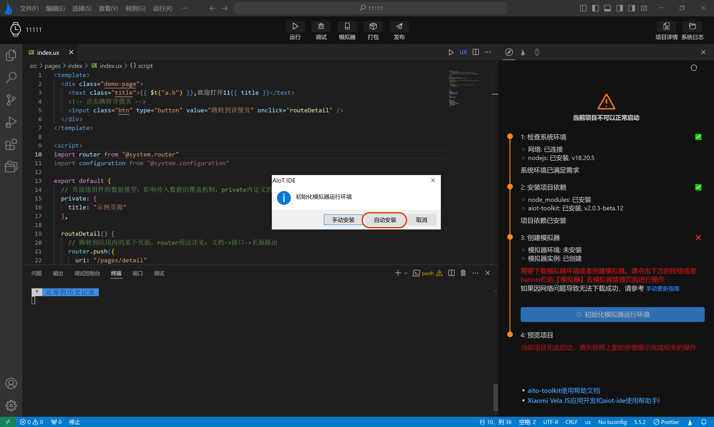

**Simulator Operation Description**

  * View Created Simulators
Click the "Simulator" button in the banner to enter the simulator list page, where you can see detailed information about the created simulators.

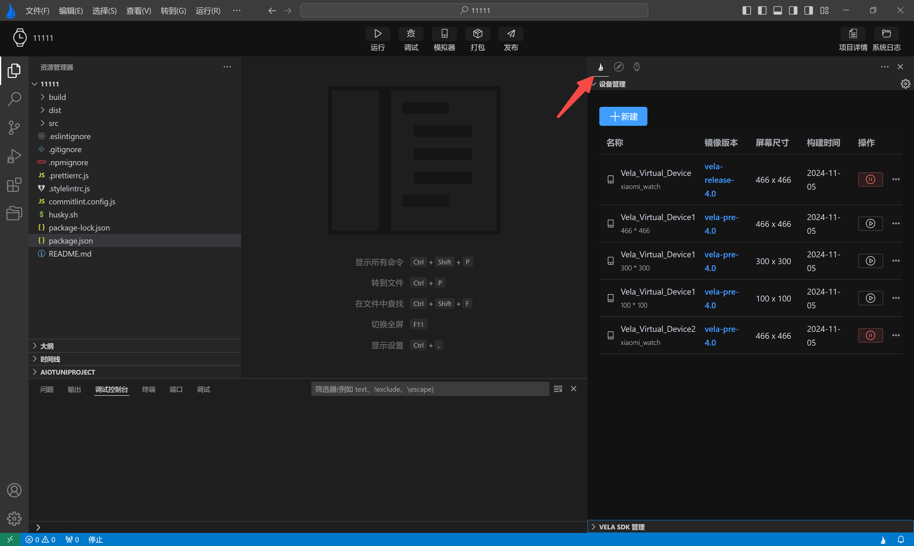

  * Create a New Simulator
    * Click the "New" button in the top-left corner of **Device Management** to enter the simulator form page.
    * On the simulator form page, fill in the information for the simulator to be created and click the "Create" button. The plugin will first download the Vela image and complete the creation.

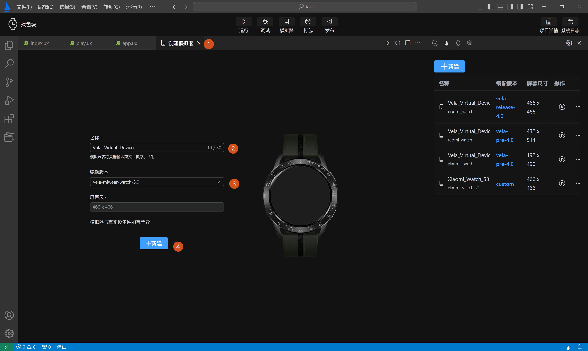

### 5\. Debugging the Project

To debug, first select the simulators on which you want to preview the effects. After selecting the devices, click the debug button to start the current Quick App in the simulator and display the project UI.

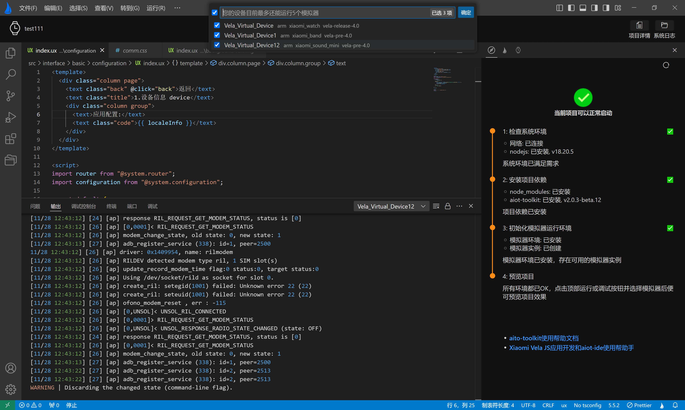

After the Quick App starts successfully, a debug panel will pop up at the bottom of AIoT-IDE. Click the tabs in the debug panel to perform corresponding operations, such as viewing the DOM tree, viewing the Console, and breakpoint debugging.

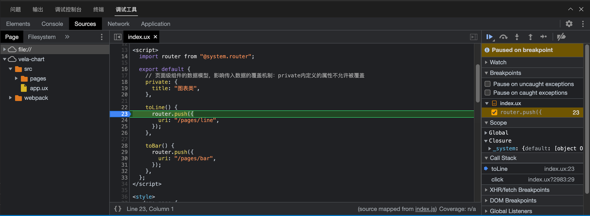

### 6\. Packaging the Project

**Development Mode Packaging**
After development is complete, you can click the "Package" button in the banner to package the application. By default, two new directories will be generated: `dist` and `build`.
The `dist` folder will contain a `.debug.rpk` file, and the `build` folder will contain the compiled JS files.

**Production Mode Packaging**

  * Before packaging, configure the signature private key to generate the signature file.

    * Auto-generate: Click the "Publish" button in the banner > Fill in the relevant information > Click the "Finish" button. The plugin will generate two files, `private.pem` and `certificate.pem`, in the project's `sign` directory. After the signature files are generated successfully, click the "Publish" button in the **top operation bar** to package the application. The output is similar to development mode packaging, but the RPK file in the `dist` folder will have a `release` suffix.

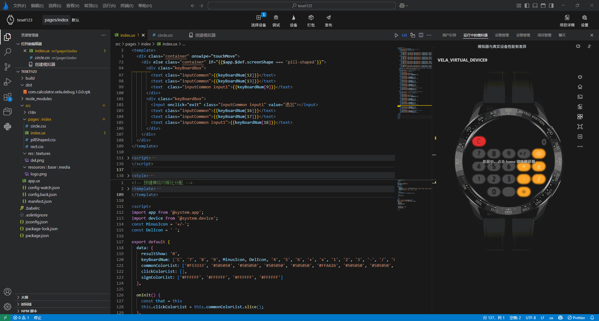

    * Auto-generation requires OpenSSL to be installed in the system environment. Windows systems may encounter OpenSSL missing issues. Here are the specific solutions:

      * Install OpenSSL and configure the system environment variables, then restart the computer. After restarting successfully, open the terminal in AIoT-IDE and enter `openssl`. If the following image is displayed, the installation is successful.

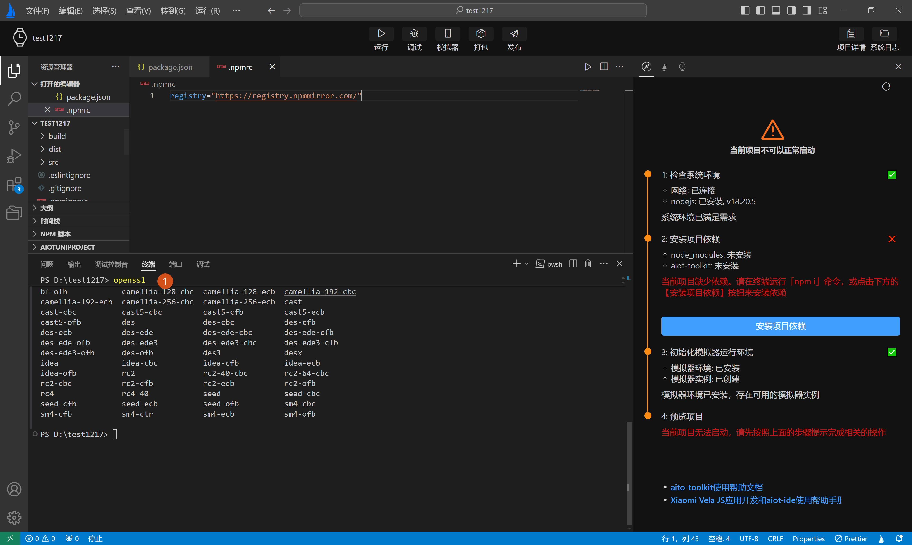

    * Manual generation: Also requires OpenSSL to be installed in the system environment. Then open the terminal and run the following command to generate the signature files. Create a new `sign` directory in the project and place the generated files `private.pem` and `certificate.pem` in this directory:
`openssl req -newkey rsa:2048 -nodes -keyout private.pem -x509 -days 3650 -out certificate.pem`
